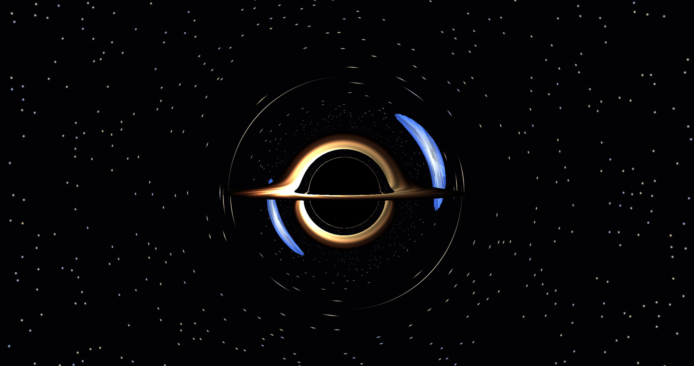

# Black Hole Gravitational Lensing Simulator



This project is written in C/C++ and OpenGL from scratch to simulate the behavior of light around a black hole. Every pixel traces a ray of light backward from the camera, bending through the curved space, and shows what light would have hit: the sky, accretion disk, distant object, or event horizon.

## Features

- **Pixel ray tracing on the GPU.** One ray per pixel, which are traced in a GLSL fragment shader.
- **Light bending around a Schwarzschild black hole**, including the photon sphere, the shadow, and higher-order images that stack up near the shadow's rim.
- **Accretion disk** between 3 and 8 Schwarzschild radii, with a temperature-style color ramp, spiral streaks, and relativistic Doppler beaming (the side moving toward you is brighter).
- **A distant glowing object** that sweeps back and forth behind the hole. Watch it form a main and a fainter second image, stretch into arcs, and close into a full Einstein ring at alignment.
- **Two skies:** a procedural star field and a checkerboard sphere, which makes the distortion easy to see.
- **Euler and RK4 integration**, switchable at runtime for comparison.
- **Orbit camera** with mouse drag and scroll zoom.
- **2D prototype** (`2Dmain.cpp`) that draws the light rays bending around the hole on the CPU.

## Controls

| Input | Action |
|---|---|
| Left mouse drag | Orbit the camera around the black hole |
| Scroll wheel | Zoom in and out |
| `1` | Star sky |
| `2` | Checkerboard sky |
| `D` | Toggle the accretion disk |
| `O` | Toggle the distant object |
| `R` | Toggle RK4 integration (off = Euler) |
| `Space` | Pause or resume the object's motion |

## Installation (Windows, MSYS2)

1. Install [MSYS2](https://www.msys2.org) and open the MSYS2 UCRT64 terminal.
2. Install the toolchain and libraries:
   ```
   pacman -S mingw-w64-ucrt-x86_64-gcc mingw-w64-ucrt-x86_64-glfw mingw-w64-ucrt-x86_64-glew
   ```
3. From the project folder, compile and run:
   ```
   g++ main3d.cpp -lglew32 -lglfw3 -lopengl32 -lgdi32 -o lensing3d.exe
   ./lensing3d.exe
   ```

The 2D prototype builds without GLEW:

```
g++ 2Dmain.cpp -lglfw3 -lopengl32 -lgdi32 -o lensing2d.exe
```

**Requires a GPU and driver with OpenGL 3.3 or newer.**

## How it works

**Rays.** For each pixel, the camera builds a direction from the pixel's position on an image plane one unit in front of it, using the field of view and the window's aspect ratio. The ray starts at the camera and is traced step by step.

**Bending light.** Light around a Schwarzschild black hole follows

```
x'' = -(3/2) * r_s * h^2 / r^5 * x,    h = |x × v|
```

where `r_s` is the Schwarzschild radius and `h` is the conserved angular momentum. This form needs only plain vector math and does not include metric tensors, and it reproduces the photon sphere at `1.5 r_s` and the capture radius of `(3√3 / 2) r_s ≈ 2.6 r_s`. The velocity is not renormalized, because doing so would break the conservation of `h`. Step size scales with distance (small near the hole, large far away).

Every step checks, in order: did it cross the event horizon (black), cross the disk plane `y = 0` between 3 and 8 `r_s` (disk color), or enter the distant sphere (object color)? Rays that escape sample the sky using their final direction.

**Disk shading.** Color runs from hot yellow-white at the inner edge to red-orange at the outer edge, fading with radius. Doppler beaming scales brightness by `D^3`, where `D = 1 / (1 - β cosθ)` and `β = sqrt(r_s / 2r)` is the orbital speed as a fraction of light speed. The disk's inner edge at `3 r_s` is the innermost stable circular orbit for a non-spinning black hole.


## Known limitations

- Non-rotating black hole only (no Kerr spin).
- The disk is an infinitely thin, opaque sheet.
- No gravitational redshift on the disk.
- The distant object is a glowing sphere that does not bend light itself. Only the black hole does.
- No galaxy or cluster lenses.
